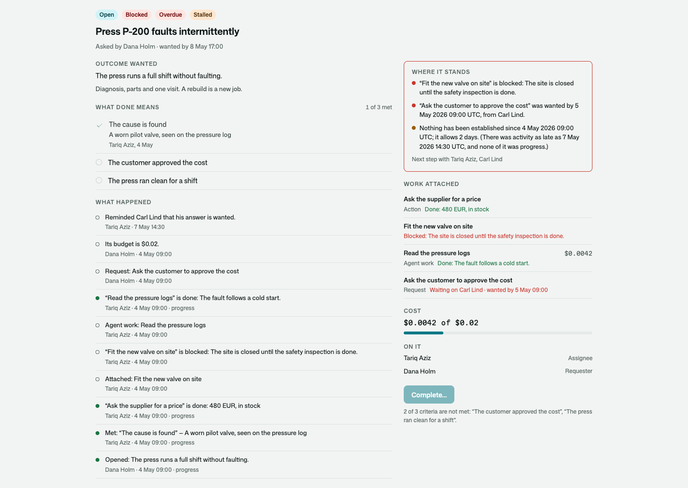
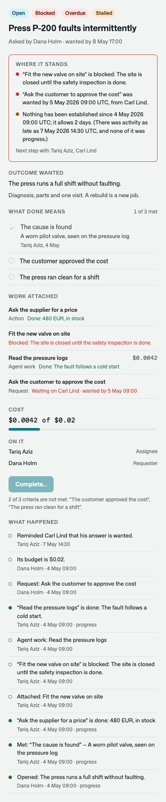
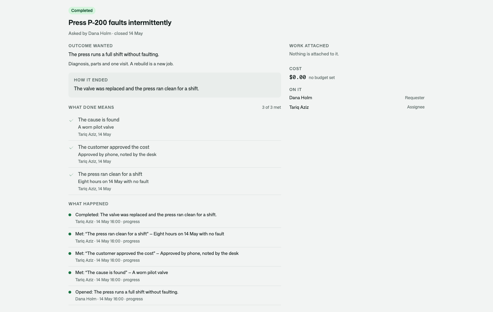

# Osysharp.Assignments

A piece of work somebody asked for, owned until its outcome is reached.

An assignment says who asked, the outcome they want, and what must be true for it to be done. Agents, processes,
questions put to people and work handed to other systems are attached to it — and any of them can fail, be replaced,
or take a month. The assignment is what stays. It completes when its criteria are met, never because everything
attached to it happens to have finished.

```osy
use Osysharp.Assignments@2;

var a = OpenAssignment(new NewAssignment {
  Title = "Press P-200 faults intermittently",
  Goal = "The press runs a full shift without faulting.",
  Criteria = ["The cause is found", "The customer approved the cost", "The press ran clean for a shift"],
  Assignees = [technician],
  DueAt = friday,
});

MeetCriterion(a.Criteria.Single(c => c.Position == 1), "A worn pilot valve, seen on the pressure log", evidence: log.Id, evidenceType: "ServiceLog");
CompleteAssignment(a, "The valve was replaced.");          // refused: two criteria are not met, and it says which
```



## Use case

Work that does not fit in one request. A customer reports a machine that faults now and then; a manager asks for a
hire; a parcel has not arrived. Somebody has to find things out, wait for other people, try again, and know when it
is over. Built by hand, that becomes a status column, a comment thread and a spreadsheet of who is waiting on whom.

- **Done is declared.** Each criterion is met with what met it — words, and the evidence or decision it rests on.
  Nothing is ticked.
- **An exception is a decision, in writing.** Closing with a criterion unmet takes somebody the app trusts with
  that, and the assignment says it was completed by exception.
- **It can be opened again.** The repair that did not hold reopens the same assignment, with every line of what
  happened, everything attached to it and what it cost.
- **Progress is not activity.** A reminder, a retry and a status summary are activity. Progress points at something
  established: evidence, a finished piece of work, a decision.
- **It says why it is not moving.** Waiting, blocked, overdue and stalled are worked out, each with its reasons and
  who the next step is with.
- **It knows what it cost.** Model calls made for it, the work attached to it, and the assignments opened under it.



## What it does

| | |
|---|---|
| **Asking for work** | `OpenAssignment(new NewAssignment { Title, Goal, Scope, Criteria, Owner, Assignees, DueAt, StalledAfter, Budget, Parent, ParentCriterion, Process, ProcessVersion })`. Whoever is signed in asked; a process that opens one names an owner. |
| **What done means** | `AddCriterion(a, text, key, metWhen)` · `MeetCriterion(criterion, metBy, evidence, evidenceType)` · `ReopenCriterion(criterion, why)` · `AcceptException(criterion, why)` · `CriterionOf(a, key)` · `CompletionOf(a)` — whether it can be completed and what stands in the way. |
| **Closing** | `CompleteAssignment(a, outcome, limitations, obligations)` — refused (`CriteriaUnmet`) while a criterion is neither met nor excepted. `CancelAssignment(a, why)` closes the work still open on it. `FailAssignment(a, why, limitations)` keeps what was established. `ReopenAssignment(a, why, noLongerMet)`. |
| **Attached work** | `AttachWork(a, new WorkAttachment { Kind, Key, Title, Subject, SubjectType, WaitingOn, WaitingFor, DueAt, Branch })` — attaching twice under one key is one piece of work. `UpdateWork` · `ProgressWork` · `NoteWorkActivity` · `BlockWork` / `UnblockWork` · `CloseWork(work, state, result)` · `CountWorkCost(work, total)`. |
| **Done once** | `DoneFor(a, key)` / `RecordDone(a, key, title, result)` — a refund, a booking, a message: a step that is run again finds what was done and does not do it twice. |
| **Progress and activity** | `NoteProgress(a, what, reference, referenceType)` — refused without something to point at. `NoteActivity(a, kind, what)` for a note, a reminder, a retry, a status summary. `LastProgressAt` and `LastActivityAt` on the assignment; `BranchesOf(a)` per parallel branch. |
| **The four conditions** | `ConditionsOf(a)` → `Waiting`, `Blocked`, `Overdue`, `Stalled`, each with its reasons; `NextStepWith`, `NextDue`, `StallsAt`, `StalledBranches`. `WhyNotMoving(a)` in a paragraph. `AssignmentsNeedingAttention()`. |
| **Linked and nested** | `Parent` and `ParentCriterion`: an assignment opened under another meets a criterion there when it completes, and puts it back in question when it is reopened. `LinkAssignments(from, to, LinkKind.DependsOn, why)` blocks `from` until `to` is completed; a circle is refused. |
| **People** | Whoever asked and whoever owns it are on it; `AddParticipant(a, person, role)` puts on an assignee, a contributor or an observer — a person or an agent's own account. `SetAssignmentOwner`, `RemoveParticipant`. |
| **Cost** | `ChargedTo(a, purpose)` is a model call charged to the assignment and held to what is left of its budget; `Assignments.Complete(a, prompt)` is the plain call. `CostOf(a)` → own calls, attached work, assignments under it, budget, what is left. `SetAssignmentBudget`, `RequireRoomIn(a)`. |
| **Dates** | `MoveAssignmentDeadline(a, dueAt, why)` and `UpdateWork(work, new WorkUpdate { DueAt, Why })` record the date it was, the date it is and why. |
| **Erasing** | An assignment is the organisation's record of work, so a person leaves it without taking it with them. `TakePersonOffAssignment(a, person, standIn, why)`: their seat goes, nothing on it is theirs, and what they did reads as done by *Somebody no longer here*. `AnonymiseAssignment(a, new AssignmentScrub { Words, StandIn })`: the words that say who a closed assignment was about are replaced ("a former customer"), or with `Blank` every sentence — and what happened stays. `EraseWordsFromActivity` for the activity alone. With [`Osysharp.Privacy`](../privacy) in the app, [`Osysharp.Privacy.Assignments`](../privacy-assignments) does all of it for a person who asks. |
| **Events** | `AssignmentErased`, `AssignmentOpened`, `AssignmentCompleted`, `AssignmentCancelled`, `AssignmentFailed`, `AssignmentReopened`, `AssignmentCriterionMet`, `AssignmentCriterionReopened`, `AssignmentExceptionAccepted`, `AssignmentWorkClosed`. Hear them with `[On]`. |
| **On a page** | `AssignmentView(id, open)` is the whole page; `AssignmentOutcome`, `AssignmentCriteria`, `AssignmentStanding`, `AssignmentWorkList`, `AssignmentLinks`, `AssignmentCostLine`, `AssignmentPeople`, `AssignmentHistory` are its sections, each placeable by itself from `SheetOf(id)`. The slot `AssignmentPanel` is where another kit adds its own section. |

## Who may do what

Three policies, each nobody's until your app answers it:

```osy
policy OpensAssignments            => IsStaff;     // asks for work
policy OverseesAssignments         => IsLead;      // reads and acts on every assignment
policy AcceptsAssignmentExceptions => IsManager;   // closes one with a criterion unmet, in writing
```

Whoever is on an assignment reads it. An assignee, a contributor, whoever asked and whoever owns it change it; an
observer reads and changes nothing. Whoever is on an assignment reads the ones opened under it. Whoever asked,
whoever owns it and whoever oversees assignments are in charge of it: they call it off, reopen it, move its date and
put people on it.

An actor that works on an assignment names it as the piece of work its changes are for:

```osy
runas (NightlyCheck, scope: assignment) { NoteProgress(assignment, "The part arrived", delivery.Id, "Delivery"); }
```

A fourth, `ErasesAssignments`, says who may take a person off assignments and erase what one says. It is nobody's
until your app says — and with `Osysharp.Privacy` it need not: a request's own run erases as the app itself.

## Your own records

An app's own record points at the assignment behind it, and its users never need the word:

```osy
entity DeliveryCase {
  [Required] ShopOrder Order;
  [Required] Assignment Assignment;       // the customer sees "your delivery case"
}
```

`Assignment` is extensible: `partial entity Assignment { Machine? Machine; }` adds what your work needs to it.



## What only the kit writes

An assignment's state, its criteria, its activity, its people and its attached work are rows in your app's database
that only this package's functions write. Each of these is a test in the kit's test app:

| | |
|---|---|
| Completing is refused while a criterion is unmet, however much work has finished | `completing_is_refused_while_a_criterion_is_unmet_however_much_work_has_finished` |
| An exception is accepted only by whoever the app trusts with it | `an_exception_is_accepted_in_writing_only_by_whoever_the_app_trusts_with_it` |
| A missed date waives nothing | `a_breach_never_waives_an_approval` |
| Reminders and retries do not move the progress clock | `reminders_and_retries_do_not_reset_the_progress_clock` |
| An assignment is read by whoever is on it and by nobody else | `an_assignment_is_read_by_whoever_is_on_it_and_by_nobody_else` |
| Somebody taken off it reads and writes nothing more | `revoking_a_permission_mid_assignment_stops_the_next_read_and_write` |
| An observer reads and changes nothing | `an_observer_reads_and_changes_nothing` |
| Nothing of it is written except by the kit | `nothing_of_an_assignment_is_written_except_by_the_kit` |
| What was done once is not done again | `what_was_done_once_for_an_assignment_is_found_and_not_done_again` |
| A call that does not fit its budget is refused before anything is sent | `a_call_that_does_not_fit_the_assignments_budget_is_refused_before_anything_is_sent` |

## Its tests

`kits/assignments/tests` is a workshop that services machines: a press that faults, a quote the customer must
approve, a part ordered once, a repair that does not hold. Suites for what done means (`criteria`), progress and the
conditions (`progress`), linked assignments (`links`), who may see and act (`security`), attached work and cost
(`work`), what stays visible (`unresolved`) and the page (`ui`).

```
osy test kits/assignments/tests
```

## Source and package

- Package: `Osysharp.Assignments` — `use Osysharp.Assignments@2;`
- Source: [`kits/assignments`](.) — `model/Setup.osy` (policies, the app's setting), `Assignment.osy` (the assignment,
  who is on it), `Criteria.osy` (criteria, closing, reopening), `Work.osy` (attached work, done once), `Activity.osy`
  (progress and activity), `Conditions.osy` (waiting, blocked, overdue, stalled), `Links.osy`, `Cost.osy`,
  `Events.osy`, `ui/` (the sheet and the page).
- Uses `Osysharp.Identity` (who asked and who is on it), [`Osysharp.Llm`](../llm) (what it cost) and `Osysharp.Ui`.
- With it: [`Osysharp.WorkRepositories`](../work-repositories) keeps what an assignment knows as items;
  [`Osysharp.Assignments.Agents`](../assignments-agents) attaches an agent's work to it.

## Changes

- 2.0.0: `WorkRow` is internal to the kit. It was never meant as part of its surface, and `Osysharp.Agents.Management`
  has a control of the same name. Pin `@2`.

## Examples

Taken from this package's own tests, which compile and run on every release.

```osy
using Osysharp.Identity;
using Osysharp.Assignments;
using Workshop;

[Test(Floor)]
void an_assignment_says_who_asked_the_outcome_wanted_and_what_done_means() {
  var job = OpenPressJob();
  runas (Dana) {
    var a = Job(job);
    Assert.Equal("Press P-200 faults intermittently", a.Title);
    Assert.Equal("The press runs a full shift without faulting.", a.Goal);
    Assert.Equal(Dana.Id, a.Requester.Id);
    Assert.Equal(AssignmentState.Open, a.State);
    Assert.Equal(["The cause is found", "The customer approved the cost", "The press ran clean for a shift"],
                 a.Criteria.OrderBy(c => c.Position).ToList().Select(c => c.Text).ToList());
    Assert.True(a.Criteria.All(c => c.State == CriterionState.Unmet));
    // Whoever asked and whoever does the work are on it from the start.
    Assert.Equal(ParticipantRole.Requester, a.Participants.Single(p => p.Person.Id == Dana.Id).Role);
    Assert.Equal(ParticipantRole.Assignee, a.Participants.Single(p => p.Person.Id == Tariq.Id).Role);
    // The workshop's own record points at it.
    Assert.Equal(a.Id, Machine.Single(m => m.Serial == "P-200").Job!.Id);
    Assert.Equal("Opened: The press runs a full shift without faulting.", ActivityOf(a)[0].Said);
  }
}
```

From [`tests/criteria.test.osy`](tests/criteria.test.osy).

```osy
using Osysharp.Identity;
using Osysharp.Assignments;
using Workshop;

[Test(Floor)]
void whoever_asked_can_be_taken_off_and_the_assignment_is_left_to_whoever_oversees() {
  var job = PressJobWithTariqsWork();
  runas (Rosa) { TakePersonOffAssignment(Job(job), Dana, "a former colleague", "She left and asked to be erased."); }
  runas (Mona) {
    var a = Job(job);
    Assert.Null(a.Requester);
    Assert.Equal("Somebody no longer here", SheetOf(a.Id).Requester);
    // It is still worked on, and still closed by what done means.
    MeetCriterion(Criterion(a, 2), "The customer approved 4,200");
    MeetCriterion(Criterion(a, 3), "It ran a shift clean");
    CompleteAssignment(a, "Repaired.");
    Assert.Equal(AssignmentState.Completed, Job(job).State);
  }
  // Tariq, the assignee, still reads and works on it as before.
  runas (Tariq) { Assert.Equal(1, Assignment.Count()); }
  runas (Dana) { Assert.Equal(0, Assignment.Count()); }
}
```

From [`tests/erasure.test.osy`](tests/erasure.test.osy).

```osy
using Osysharp.Identity;
using Osysharp.Assignments;
using Workshop;

[Test(Floor)]
void reopening_the_one_below_puts_the_criterion_above_back_in_question() {
  var recall = OpenRecall();
  var first = OpenUnder(recall.Id, "P-200", Tariq.Id);
  runas (Tariq) {
    MeetCriterion(Job(first).Criteria.Single(), "Fitted and tested");
    CompleteAssignment(Job(first), "The new valve is in.");
  }
  Background.Settle();
  runas (Mona) { Assert.Equal(CriterionState.Met, Job(recall).Criteria.Single(c => c.Position == 2).State); }

  runas (Mona) { ReopenAssignment(Job(first), "The new valve leaks."); }
  Background.Settle();
  runas (Mona) {
    var bound = Job(recall).Criteria.Single(c => c.Position == 2);
    Assert.Equal(CriterionState.Unmet, bound.State);
    Assert.Equal(1, bound.Reopened);
    Assert.Contains("Back in question: “P-200 has the new valve” — “New valve on P-200” was opened again. (It was met by: “New valve on P-200” is completed..)",
                    ActivityOf(Job(recall)).Select(l => l.Said).ToList());
  }
}
```

From [`tests/links.test.osy`](tests/links.test.osy).

## Learn more

- [The Osysharp.Assignments reference](https://osysharp.com/reference/agent/kit-assignments/)
- [Osysharp.Assignments in the package catalogue](https://osysharp.com/packages/#osysharp-assignments)
- [The Osy# reference](https://osysharp.com/reference/) — the language, the runtime and every kit
- [`llms-full.txt`](https://osysharp.com/llms-full.txt) — the whole reference and specification as one Markdown file, for a coding agent

## Licence

MIT — see [`LICENSE`](LICENSE).
