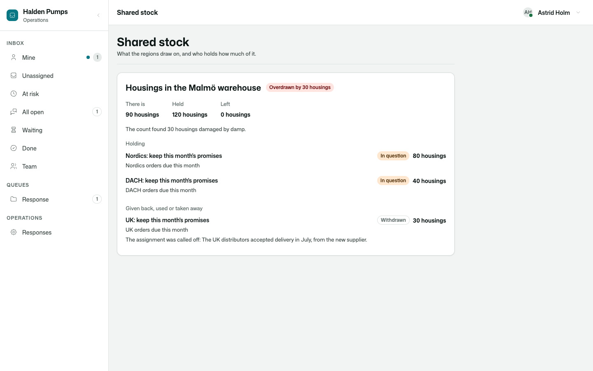
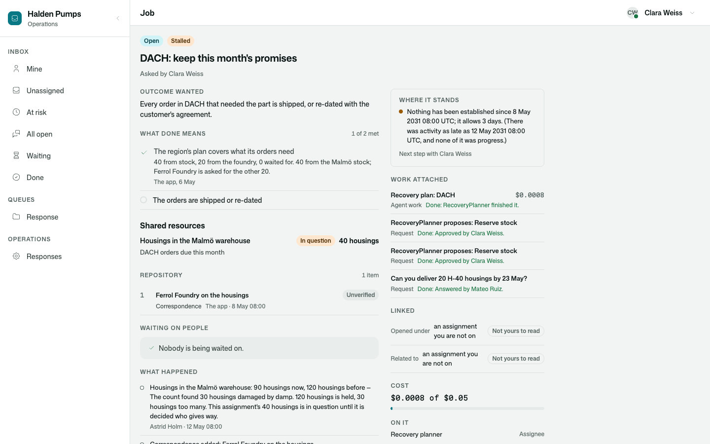

# Osysharp.Assignments.Allocations

What several assignments compete for — and who holds how much of it.

```osy
use Osysharp.Assignments@2;
use Osysharp.Assignments.Allocations@1;

policy KeepsSharedPools      => IsOperations;                  // says what there is; decides who gives way
policy ClaimsFromSharedPools => IsOperations || IsRegionLead;  // sees the pools; claims for a job they act on

var stock = OpenPool(new NewPool { Key = "malmo-housings", Title = "Housings in the Malmö warehouse", Unit = "housings", Available = 120 });

Claim(stock, nordics, 80, "Nordic orders due this month");     // held: nobody else can take these 80
Claim(stock, dach, 60, "DACH orders due this month");          // refused — 40 are left, and it says what the rest is held for
AskFor(stock, uk, 30, "UK orders due this month");             // nothing is left: it waits its turn, and its job says so

CorrectPool(stock, 90, "The count found 30 housings damaged by damp.");   // 120 are held: the pool is overdrawn
CutAllocation(nordicsClaim, 50, "Nordic orders 14 to 19 can ship in June.");   // the keeper decides who gives way
```



## Use case

A pump maker's supplier of housings shuts down. Three sales regions have orders that need the 120 housings left in
one warehouse. Each region's recovery is its own job, planned by somebody who sees their own part — and all three
draw on the same stock. Without one place that says who holds what, two plans are both approved for the same
housings, and nobody finds out until a lorry is loaded.

- **Two assignments never hold the same unit.** A claim is held, or refused saying how much is left and what the
  rest is held for. Claimed again under the same key — a step run again after a crash — it is the claim already
  made.
- **A claim that does not fit can wait its turn.** The assignment then carries a piece of blocked work that says
  what it is waiting for; waiting claims are served in the order they asked, when room appears.
- **Less than was thought is somebody's decision.** A count that finds less than is held overdraws the pool. Nothing
  is taken from anybody: every holder is told its share is in question, nothing of it can be used, and whoever keeps
  the pool decides who gives way. `PoolOverdrawn` and `AllocationCut` are events an app hears to plan again.
- **What is used is gone.** `UseAllocation` takes it out of the pool for good.
- **An assignment that closes holds nothing.** Completed, called off or failed, what it held goes back and whoever
  waited is served.
- **Whoever sees a pool need not be on the assignments that draw on it.** A claim says what it is for in its
  claimant's own words, and that is what the others read; an assignment's title is shown only to who may read it.



## What it adds

| | |
|---|---|
| `SharedPool`, `Allocation` | the pool and one assignment's claim on it |
| `OpenPool` · `PoolBy` · `LeftIn` | open a pool (or find the one open under the key); how much nobody holds |
| `Claim` · `AskFor` | hold now or be refused (`NotEnoughLeft`) · hold now or wait in turn |
| `ReleaseAllocation` · `UseAllocation` | give back · used up |
| `CorrectPool` · `CutAllocation` | what there is now · who gives way — for whoever keeps the pool |
| `PoolOf` · `AllocationsOf` | a pool, and an assignment's claims, as whoever is looking may read them |
| `PoolCard(pool)` | the pool on a page |
| "Shared resources" on every assignment's page | a contribution to `AssignmentPanel` |
| `AllocationHeld` · `AllocationWaiting` · `AllocationReleased` · `PoolOverdrawn` · `AllocationCut` · `PoolChanged` | events |
| `policy KeepsSharedPools` · `policy ClaimsFromSharedPools` | nobody, until the app says |

## Its tests

`kits/assignments-allocations/tests` is Halden Pumps, whose supplier of housings shuts down. The response is walked
from the first report to every commitment fulfilled or resolved, over two weeks: agents assess and plan; each
region's lead approves what is taken from the shared stock — one proposal is refused by a person, one by the stock,
one region waits; a foundry outside answers through a link; a region's job is handed over and then called off; a
count finds less than is held, the director decides who gives way, and that region plans again. The one model is
scripted. No model is ever called.

| | |
|---|---|
| A claim is held, and one that does not fit is refused | `a_claim_is_held_and_one_that_does_not_fit_is_refused_saying_who_holds_the_rest` |
| The same key is the same claim | `a_claim_made_again_under_the_same_key_is_the_claim_already_made` |
| Waiting, and being served in turn | `a_claim_that_does_not_fit_can_wait_and_is_served_in_the_order_it_asked` |
| A closed job holds nothing | `a_job_that_is_closed_holds_nothing_and_whoever_waited_is_served` |
| Overdrawn, and who gives way | `less_than_was_thought_overdraws_the_pool_and_its_keeper_decides_who_gives_way` |
| Who may do what | `each_person_does_what_is_theirs_with_a_pool_and_nothing_else` |
| The whole response, day by day | `a_disruption_is_answered_region_by_region_from_one_stock_and_planned_again_when_the_stock_falls_short` |
| The run tells it | `the_run_of_a_response_tells_the_plan_the_shortfall_and_the_plan_made_again` |
| Each reader sees what is theirs | `each_reader_of_a_response_sees_what_is_theirs` |
| On screen: the stock overdrawn, a region's job, the revised plan in an inbox, the run — wide and on a phone, light and dark | four tests in `response-ui.test.osy` |

```
osy test kits/assignments-allocations/tests            # 13 tests
osy test kits/assignments-allocations/tests --pixels   # the same in a real browser, photographed
```

Two claims made at the same moment cannot both pass because the pool's held amount is checked on every write
(`[ConcurrencyCheck]`). That is the platform's check; one test body is one writer, so no test here stages the race.

## Source and package

- Package: `Osysharp.Assignments.Allocations` — add `use Osysharp.Assignments.Allocations@1;`
- Source: [`kits/assignments-allocations`](.) — `model/Pools.osy`, `model/ui/Pools.osy`
- Uses [`Osysharp.Assignments`](../assignments) and `Osysharp.Ui`.

## Examples

Taken from this package's own tests, which compile and run on every release.

```osy
using Osysharp.Identity;
using Osysharp.Assignments;
using Osysharp.Assignments.Allocations;
using Pumpworks;

[Test(Plant)]
void a_claim_is_held_and_one_that_does_not_fit_is_refused_saying_who_holds_the_rest() {
  var jobs = ThreeJobsAndAPool();
  runas (Bram) {
    var held = Claim(Stock(), JobBy(jobs[0]), 80, "Nordic orders due this month", key: "stock");
    Assert.Equal(AllocationState.Held, held.State);
    Assert.Equal(80, Stock().Held);
    Assert.Equal(40, LeftIn(Stock()));
    // It is said on the job, where whoever follows the job reads it.
    Assert.True(ActivityOf(JobBy(jobs[0]), 20).Any(l => l.Said == "Holds 80 housings of Housings in the Malmö warehouse: Nordic orders due this month"));
  }
  runas (Clara) {
    var refused = Assert.Throws<NotEnoughLeft>(() => Claim(Stock(), JobBy(jobs[1]), 60, "DACH orders due this month", key: "stock"));
    Assert.Equal("40 housings of Housings in the Malmö warehouse are left, and “DACH” asked for 60 housings. Held: 80 housings for Nordic orders due this month.", refused.Message);
    Assert.Equal(40, refused.Left);
    // Nothing was taken by the claim that was refused.
    Assert.Equal(80, Stock().Held);
    Assert.Equal(0, Allocation.Count(c => c.Assignment.Id == jobs[1]));
    // She sees the pool, and what each share of it is for — not the other job, which is not hers to read.
    var view = PoolOf(Stock().Id);
    Assert.Equal(["Nordic orders due this month"], view.Holding.Select(l => l.Why).ToList());
    Assert.Equal([""], view.Holding.Select(l => l.AssignmentTitle).ToList());
    Assert.Equal(0, Assignment.Count(a => a.Id == jobs[0]));
    // What is left can be had.
    Claim(Stock(), JobBy(jobs[1]), 40, "DACH orders due this month", key: "stock");
    Assert.Equal(0, LeftIn(Stock()));
  }
}
```

From [`tests/pools.test.osy`](tests/pools.test.osy).

```osy
using Osysharp.Identity;
using Osysharp.Assignments;
using Osysharp.Assignments.Allocations;
using Pumpworks;

[Test(Plant)]
void a_claim_made_again_under_the_same_key_is_the_claim_already_made() {
  var jobs = ThreeJobsAndAPool();
  runas (Bram) {
    var first = Claim(Stock(), JobBy(jobs[0]), 80, "Nordic orders due this month", key: "stock");
    var again = Claim(Stock(), JobBy(jobs[0]), 80, "Nordic orders due this month", key: "stock");
    Assert.Equal(first.Id, again.Id);
    Assert.Equal(80, Stock().Held);
    Assert.Equal(1, Allocation.Count());
  }
}
```

From [`tests/pools.test.osy`](tests/pools.test.osy).

```osy
using Osysharp.Identity;
using Osysharp.Assignments;
using Osysharp.Assignments.Allocations;
using Pumpworks;

[Test(Plant)]
void a_job_that_is_closed_holds_nothing_and_whoever_waited_is_served() {
  var jobs = ThreeJobsAndAPool();
  runas (Bram) { Claim(Stock(), JobBy(jobs[0]), 100, "Nordic orders due this month", key: "stock"); }
  runas (Clara) { AskFor(Stock(), JobBy(jobs[1]), 60, "DACH orders due this month", key: "stock"); }
  runas (Deniz) { AskFor(Stock(), JobBy(jobs[2]), 30, "UK orders due this month", key: "stock"); }

  // The Nordic job is called off: what it held goes back, and both who waited are served, in turn.
  runas (Bram) { CancelAssignment(JobBy(jobs[0]), "The Nordic customers took another pump."); }
  Background.Settle();
  runas (Astrid) {
    Assert.Equal(AllocationState.Released, ClaimOf(jobs[0]).State);
    Assert.Equal("The assignment was called off: The Nordic customers took another pump.", ClaimOf(jobs[0]).Note);
    Assert.Equal(AllocationState.Held, ClaimOf(jobs[1]).State);
    Assert.Equal(AllocationState.Held, ClaimOf(jobs[2]).State);
    Assert.Equal(90, Stock().Held);
  }
  // A job that was waiting and is called off waits no more, and a closed job claims nothing.
  runas (Deniz) {
    CancelAssignment(JobBy(jobs[2]), "The UK customers agreed to wait.");
    Assert.Throws<AssignmentClosed>(() => Claim(Stock(), JobBy(jobs[2]), 5, "More", key: "late"));
  }
  Background.Settle();
  runas (Astrid) {
    Assert.Equal(AllocationState.Released, ClaimOf(jobs[2]).State);
    Assert.Equal(60, Stock().Held);
  }
}
```

From [`tests/pools.test.osy`](tests/pools.test.osy).

## Learn more

- [The Osysharp.Assignments.Allocations reference](https://osysharp.com/reference/agent/assignment-allocations/)
- [Osysharp.Assignments.Allocations in the package catalogue](https://osysharp.com/packages/#osysharp-assignments-allocations)
- [The Osy# reference](https://osysharp.com/reference/) — the language, the runtime and every kit
- [`llms-full.txt`](https://osysharp.com/llms-full.txt) — the whole reference and specification as one Markdown file, for a coding agent

## Licence

MIT — see [`LICENSE`](LICENSE).
