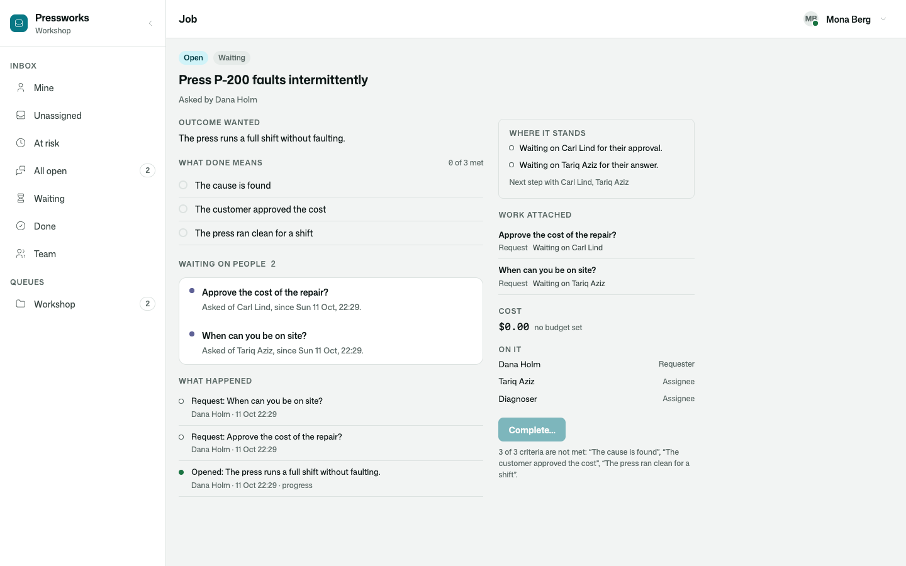
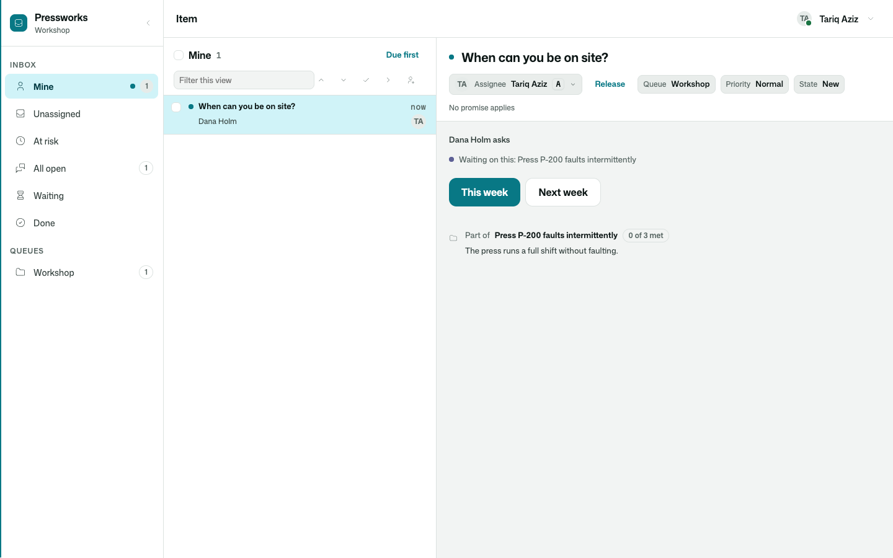

# Osysharp.Assignments.WorkQueues

What an assignment asks of people — in their inboxes, and on the assignment.

An [assignment](../assignments) is owned until it is done. A [request](../human-requests) is an item in a person's
work queue until it is answered. With both in an app, a request put for an assignment is a piece of the assignment's
work, and stays in step with it.

```osy
use Osysharp.Assignments@1;
use Osysharp.HumanRequests@1;
use Osysharp.Assignments.WorkQueues@1;

var request = AssignmentRequests.Ask(job, new NewRequest {
  Kind = RequestKind.Approval, To = customer, Title = "Approve the cost of the repair?",
  About = Subject.Of("RepairQuote", quote.Id, "The quote for the press", version: "r" + quote.Revision),
}, key: "quote");
```



## Use case

A job stalls on people more often than on anything else: the customer has not approved the cost, the technician has
not said when he can come. Kept by hand, "who are we waiting on?" is a column somebody forgets to update, and the
person asked finds out by being chased.

- **One call.** `AssignmentRequests.Ask` puts the request and attaches it to the assignment: who the next step is
  with, what is waited for, when it is wanted by.
- **In their inbox, whether or not they are on the job.** A customer answers what they are asked and reads nothing
  of the assignment itself.
- **An answer closes the work and completes nothing.** The assignment is done when its criteria are met. A request
  that ran out of time closes as failed and waives nothing.
- **What an agent asks is attached by itself.** A proposal or a question from an agent working for the assignment
  is the assignment's too.
- **The trail says what happened.** That it was asked, reminded, late, moved on to somebody else, answered.
- **Safe to repeat.** Asked again under the same key, nothing is put twice.



## What it does

| | |
|---|---|
| **Asking** | `AssignmentRequests.Ask(assignment, new NewRequest { … }, key:, branch:)` — the request, and a piece of attached work of kind `Request` that stands for it. |
| **Reading** | `AssignmentRequests.Open(assignment)` · `AssignmentRequests.Of(request)` · `AssignmentRequestIds(assignment)` · `AssignmentTagOf(request)`. |
| **Kept in step** | answered → the work is `Done`, with who and what; out of time → `Failed`; called off → `Cancelled`; late, reminded, given a new date → on the assignment's trail, and its date moves. |
| **Agents** | a request that waits on a piece of an assignment's agent work is attached to the same assignment. |
| **Screens** | "Waiting on people" on every assignment's page · "Part of …" on the request's item in the inbox, for whoever may read the assignment. |

## Tests

`tests/` is a workshop that services presses: the customer is asked to approve the cost, the technician when he can
visit, and an agent that reads the fault log proposes to order a part. 6 tests — every open request in its person's
inbox and on the job's trail, an answer that closes its work and completes nothing, a request called off and one out
of time, asking twice under one key, an agent's proposal attached by itself — and the two screens driven as a person
(`osy test --pixels`).

## Source and package

- Source: [`kits/assignments-work-queues`](.) — Osy#, readable and forkable.
- Package: `Osysharp.Assignments.WorkQueues` · completes `Osysharp.Assignments` and `Osysharp.HumanRequests` (whose
  requests are items of `Osysharp.WorkQueues`).
- Reference: `osy docs agent-assignment-requests`.
